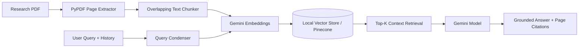

# Research Paper RAG Chat

A conversational Retrieval-Augmented Generation (RAG) assistant for querying academic PDFs with page-level source citations. Built with the Google Gemini API (`google-genai`) for embeddings and chat generation, supporting both a zero-setup local NumPy vector index and an optional Pinecone Serverless backend.

## Architecture



## Project Structure

```text
.
├── data/
│   └── RAGPaper.pdf                # Sample research paper
├── notebooks/
│   ├── local_rag_chatbot.ipynb     # Walkthrough using local vector store
│   └── pinecone_rag_chatbot.ipynb  # Walkthrough using Pinecone Serverless
├── src/
│   ├── config.py                   # Environment & runtime settings
│   ├── loader.py                   # PDF extraction & overlapping chunker
│   ├── vectorstore.py              # LocalVectorStore & PineconeVectorStore
│   └── rag.py                      # Conversational RAG pipeline
├── tests/
│   └── test_rag.py                 # Unit tests for chunking, search, and QA
├── main.py                         # Interactive CLI chat entry point
├── requirements.txt
└── .env.example
```

## Setup

1. **Install dependencies**

   ```bash
   pip install -r requirements.txt
   ```

2. **Configure environment variables**

   ```bash
   cp .env.example .env
   ```

   Open `.env` and set your `GEMINI_API_KEY` (and `PINECONE_API_KEY` if you plan to use `--backend pinecone`).

## Usage

### Interactive CLI

Start chatting with the included sample paper:

```bash
python main.py --pdf data/RAGPaper.pdf
```

Options:

- `--pdf <path>`: Path to any PDF document (defaults to `data/RAGPaper.pdf`).
- `--backend local|pinecone`: Choose between the cached local NumPy index (`local`, default) or Pinecone Serverless (`pinecone`).
- `--rebuild`: Force re-chunking and re-embedding even if a cached local index already exists.
- `--top-k <n>`: Number of relevant chunks to retrieve per question (defaults to `4`).

Inside the chat loop, type `clear` to reset conversation memory or `exit` / `quit` to leave.

### Jupyter Notebooks

- `notebooks/local_rag_chatbot.ipynb` — step-by-step indexing and conversational Q&A using `LocalVectorStore`.
- `notebooks/pinecone_rag_chatbot.ipynb` — indexing and querying via `PineconeVectorStore`.

## Running Tests

```bash
pytest
```

